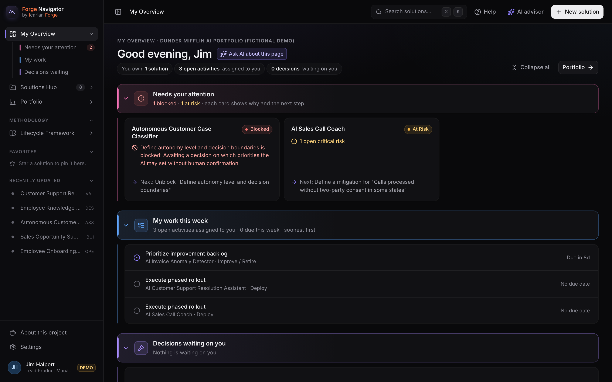
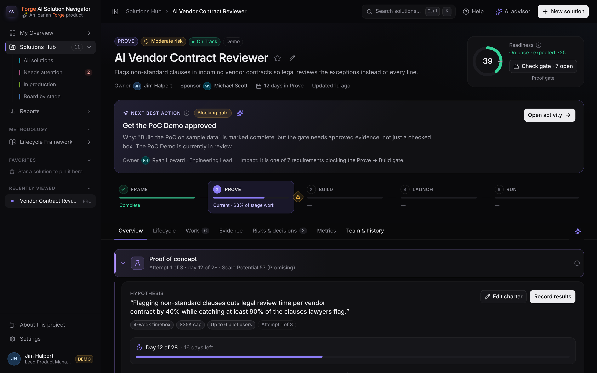
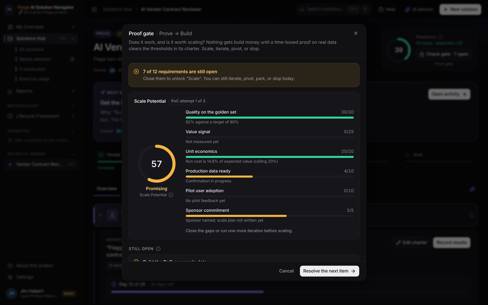

# Forge AI Solution Navigator

[](https://github.com/lautbzehn/ai-solution-navigator/actions/workflows/ci.yml)

**Live demo: [navigator.icarianforge.com](https://navigator.icarianforge.com)** · **[The story behind it](docs/case-study_v1.3_10.11.2026.md)**: why I built it and the choices I made along the way

**A Product Manager's workspace for taking AI solutions from opportunity to production.**



<p>
  
  
</p>

*Left: one project's workspace, with its proof of concept read against the charter. Right: the Proof gate, where the sponsor decides to scale, iterate, pivot, or stop.*

Hi, I'm Dan West. If you've ever watched an AI pilot stall somewhere between "this works" and "this is live," this is for you. The Navigator shows, for every AI project at once, *where it is, what's next, who owns it, what proof is still missing, and whether it's really ready to move forward.*

It follows 5 stages (Frame → Prove → Build → Launch → Run) with one rule at its heart: **prove it small before you build it big.** Nothing gets build money until a time-boxed proof of concept clears the bar its sponsor agreed to up front, and every gate can stop a project early. Checks get stricter as the risk goes up. It's meant to sit alongside your compliance tools, not replace them. Inside the app, **About this project** tells the story and how to reach me.

> All people, companies, solutions, and figures are fictional demo data (Dunder Mifflin, with The Office cast).

## What it does

- **Portfolio dashboard:** KPIs, the proof of concept funnel (framed, proved, scaled, live) with kill rate and time to stop, lifecycle distribution, readiness trend, risk and value, and the solutions that need attention. Every chart drills down.
- **Proof of concept checkpoint:** each idea gets a PoC charter (hypothesis, timebox, budget cap, pilot user cap, quality, value, and cost thresholds) before the test starts. The Proof gate reads the results against it and scores **Scale Potential** (0 to 100) across quality, value, unit economics, data readiness, pilot adoption, and sponsor commitment.
- **Real decisions at every gate:** advance, iterate (up to twice), pivot, roll back, park, or stop, decided by a named approver who is never the solution's own owner, with a required reason. Stopped work keeps its lesson; parked work resumes where it left off.
- **Solution workspace:** a lifecycle rail, a **Next Best Action** with owner and impact, and seven tabs: Overview, Lifecycle, Work, Evidence, Risks & decisions, Metrics, and Team & history. Busy views fold into collapsible sections whose headers carry a one-line headline.
- **Real gate validation:** each stage's exit gate combines blocking activities (which ones block depends on the risk tier) with explicit criteria (fields, roles, metrics, PoC results, risk rules). A completed activity *without approved evidence* does not pass. A blocked gate explains why, with owners and links to resolve. Looking at a gate is free; only asking to advance before it's ready counts as a failed attempt.
- **Implementation readiness:** seven weighted dimensions (configurable). Every score shows its why, its gaps, and what would raise it. It measures implementation readiness, not AI safety alone.
- **Risk-based rigor:** changing a solution's risk tier reshapes its plan. High risk adds autonomy boundaries, override controls, adversarial testing, executive risk acceptance, and board approval.
- **Portfolio Intelligence:** health, the PoC funnel and kill rate, delivery performance (time per stage, gate pass rate, rework), lifecycle bottlenecks, risk heat map, business outcomes, adoption, and AI performance, with deterministic key insights.
- **AI advisor:** a contextual advisor that analyzes → recommends → explains. A star icon on each section asks it for an analysis of just that area. It runs as live Claude when a server key is configured, behind per-visitor rate limits and a daily spend cap, and falls back to built-in deterministic guidance ($0) whenever Claude isn't available. It never approves, changes lifecycle state, or makes legal or security determinations.
- **Audit and change log:** every change is recorded with who, what, from, and to.

## Demo script (5 minutes)

1. **Dashboard**: 10 active solutions, 2 need attention. Open **Proof of concept funnel**: 11 framed, 10 proved, 7 scaled, 2 live, with a 13% kill rate.
2. Open **AI Vendor Contract Reviewer** (Prove, day 12 of 28). Its charter promises 40% faster review at 90% quality. Quality is in, the value signal isn't yet, so Scale Potential reads 57, *Promising*.
3. Click **Record results** and enter a 44% improvement, 6 pilot users, and 83% who'd keep using it. Watch the score climb.
4. Open **AI Meeting Minutes Generator**: stopped at the Proof gate after missing its charter, with the lesson kept. That's the system working.
5. Open **AI Customer Support Resolution Assistant** (Build, Moderate risk, **73% ready**). Next Best Action: *Validate human oversight in practice*, owner Dwight Schrute. Click the star icon to ask the AI advisor.
6. Click **Check gate**: Release readiness is blocked by 3 items (oversight validation, UAT, monitoring plan). Click **Resolve the next item**.
7. Mark the oversight activity **Complete**: the gate still flags the draft evidence. Approve it and readiness rises. Resolve UAT and the monitoring plan the same way.
8. **Release to a pilot**: Michael Scott records the decision with a reason. It lands in the decision log. Reset from **Settings** when you're done.

## Run locally

```bash
npm install
npm run dev        # http://localhost:5173
npm test           # domain and server tests
npm run build      # type-check and production build
```

Data persists in your browser (localStorage), so every viewer gets a private sandbox. **Settings → Reset demo data** restores the starting portfolio.

### Live AI advisor (optional)

The advisor works out of the box in built-in mode. To use Claude:

```bash
cp .env.example .env
# set ANTHROPIC_API_KEY=... (server-side only; never sent to the browser)
# optional: ADVISOR_MODEL (defaults to claude-opus-5-5)
npm run dev
```

The browser sends a compact JSON snapshot of the current solution to `/api/advisor`; the server calls the Messages API with structured JSON output and server-side refusal fallback, then validates the response. Any failure falls back to built-in guidance with a clear notice.

**Guardrails** (`server/guard.ts`), checked before any money is spent:

- Only the app itself may call it (origin and client header checks), and requests over 64 KB are refused.
- Each visitor (an anonymous hash, never a raw IP) gets 6 questions a minute and 20 a day.
- The whole site has a daily budget, `ADVISOR_DAILY_BUDGET_USD` (default $5). Past it, everyone gets built-in guidance until midnight UTC.
- Every call logs model, tokens, cost, and latency (`advisor_call`), and an `advisor_budget_alert` line once spend passes 80% of the budget.

On Cloudflare the counters live in one Durable Object (`AdvisorGuardObject`), so limits hold across every edge location. Locally they live in memory.

## Deploy (Cloudflare Workers)

The app runs as a Cloudflare Worker at `navigator.icarianforge.com`. Static files come from `./dist`; only `/api/*` reaches the Worker (`worker/index.ts`).

```bash
npm run deploy                                  # build + wrangler deploy
npx wrangler secret put ANTHROPIC_API_KEY       # turns on the live advisor
```

The daily budget is the `ADVISOR_DAILY_BUDGET_USD` variable in `wrangler.jsonc`, and the app enforces it on its own. To see spend, search the Worker's logs in the Cloudflare dashboard for `advisor_call` (every answer, with tokens and cost) and `advisor_budget_alert` (the day passed 80% of its budget). For a second line of defense outside the app, give the API key its own workspace in the Anthropic Console with a monthly spend limit.

## Architecture

```
src/config/lifecycle.json   The methodology: stages, activities, evidence, gates and their outcomes, risk tiers, roles, readiness weights
src/domain/                 Pure logic: readiness, gates, proof and Scale Potential, health, next best action, plan instantiation, reports, validation
src/data/                   Zustand store (actions + audit trail), persistence adapter, seed data, derived hooks
src/ai/                     Advisor contract, context builder, deterministic advisor, client
server/advisor.ts           Server-side Claude integration (shared by the Vite dev middleware and the Worker)
server/guard.ts             Advisor guardrails: rate limits, daily budget, cost accounting
worker/index.ts             Cloudflare Worker: serves the app and /api/advisor, plus the guard's Durable Object
src/components/             Design system: UI primitives, charts, lifecycle rail, readiness gauge
src/features/               Screens: dashboard, solutions, workspace, reports, framework, settings, advisor, create flow
```

UI → application logic (domain) → data layer → AI integration. The lifecycle is never hard-coded into components; edit `lifecycle.json` and the plan, gates, readiness, Framework page, and reports all follow.

**Persistence:** the store talks to a `StateStorage` adapter (`src/data/storage.ts`). It's browser-local so the public demo never mixes visitors' data; swapping in SQLite or a REST API is a one-file change.

## Stack

React 19 · TypeScript · Vite · Tailwind CSS v4 · Radix UI primitives · Recharts · Zustand · Anthropic TypeScript SDK (server only).

Design direction drew on two 21st.dev references, adapted to the app's own tokens: the **Charcoal Ink dashboard sidebar** (arunjdass) for the shell, and the **Layro Charts & KPI Cards** kit (uvain) for chart and KPI conventions (thin marks, direction-aware KPIs, hidden data tables for screen readers).
