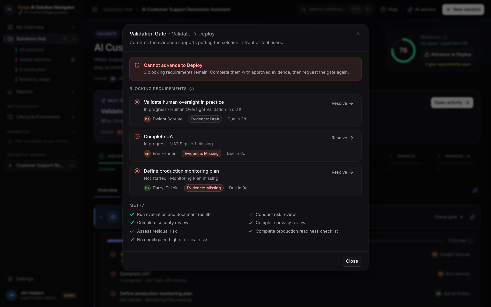
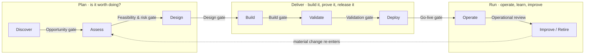
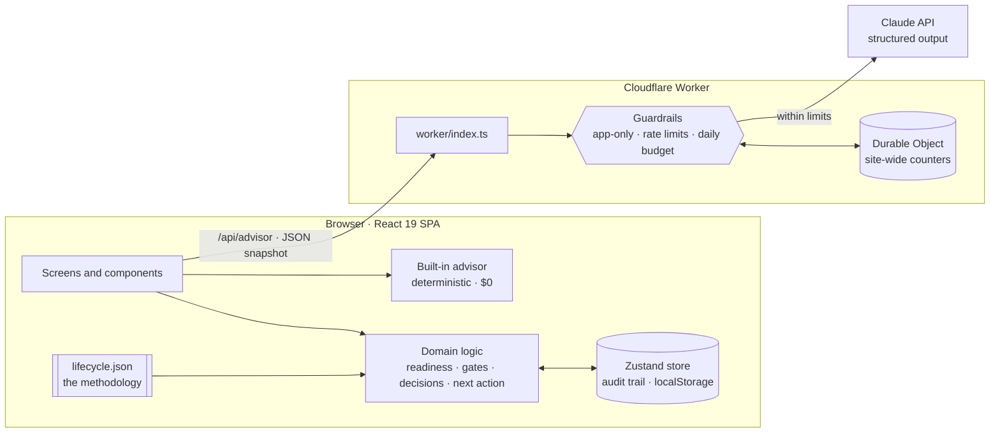

<picture>
  <source media="(prefers-color-scheme: dark)" srcset="docs/assets/banner-dark.svg">
  
</picture>

<p align="center">
  <a href="https://navigator.icarianforge.com"></a>
  <a href="https://github.com/lautbzehn/ai-solution-navigator/actions/workflows/ci.yml"></a>
  
  
  
  
  
  <a href="LICENSE"></a>
</p>

<p align="center">
  <a href="https://navigator.icarianforge.com"><b>Try the live demo</b></a> ·
  <a href="docs/case-study_v1.4_10.11.2026.md">The story behind it</a> ·
  <a href="docs/architecture_v1.0_10.11.2026.md">Architecture</a> ·
  <a href="docs/adr">Decision records</a> ·
  <a href="CHANGELOG.md">Changelog</a>
</p>

---

## In one minute

**The problem.** AI pilots go well, then stall somewhere between *"this works"* and *"this is live."* Nobody is quite sure what stage a project is in, what proof is still missing, or whose turn it is. Projects get waved through because someone said the work was done, while the evidence is still sitting in an email.

**What the Navigator does.** It's the product manager's workspace for an enterprise AI rollout. For every AI initiative at once, it shows **where it stands, what's next, who owns it, what proof is missing, and whether it's really ready.** Each project moves through eight stages, and each stage ends in a gate where a named person decides: **Go**, **Hold**, or **Stop**.

**Why it's credible.** The lifecycle follows recognized practice rather than inventing its own: the AI system life cycle in **ISO/IEC 22989**, the **NIST AI Risk Management Framework**, and **Stage-Gate** decision points. The product manager's view sits on top.

> Built by **[Dan West](https://www.icarianforge.com)**, an AI strategy and adoption leader with nearly 20 years in IT. I designed it and directed Claude Code as the engineering team, the same way I'd lead a product team. All people, companies, and figures in the demo are fictional (Dunder Mifflin, with The Office cast).

<p>
  
</p>
<p>
  
  
</p>

## Highlights

| | What it means for a team | How it works |
|---|---|---|
| **"Done" means done** | A box ticked without signed-off proof doesn't count. | Gate criteria require approved evidence, not just completed tasks. |
| **The right person decides** | Gates can't be rubber-stamped by the person running the project. | Each gate names its gatekeeper roles; the solution owner is excluded (separation of duties). |
| **Go, Hold, or Stop** | Pausing or stopping early is a valid outcome, not a failure. | Holds keep every bit of progress; stops keep the record and the reason. Every call is logged. |
| **Rigor scales with risk** | Small, low-risk helpers stay light; high-risk systems get more care. | Changing the risk tier reshapes the plan: a high-risk solution picks up 20 extra controls. |
| **A score that tells you what to do** | Readiness comes with its why, its gaps, and the next move. | Seven weighted dimensions, including the ones that get skipped, like adoption. |
| **The AI advises, people decide** | The built-in advisor explains and recommends; it never approves. | Live Claude behind rate limits and a daily budget, with a free deterministic fallback. |
| **One methodology file** | Every company's process is a little different. | Stages, activities, evidence, gates, roles, and weights live in [`lifecycle.json`](src/config/lifecycle.json), not in code. |

## The lifecycle



| Gate | Decided by | Maps to ISO/IEC 22989 |
|---|---|---|
| Opportunity | Executive Sponsor or Business Owner | Inception |
| Feasibility & Risk | Executive Sponsor or Governance / Risk | Inception |
| Design | Executive Sponsor or AI / Solution Architect | Design and development |
| Build | AI / Solution Architect or QA / Evaluation | Design and development |
| Validation | Executive Sponsor or Governance / Risk | Verification and validation |
| Go-Live | Executive Sponsor or Operations | Deployment |
| Operational Review | Executive Sponsor or Business Owner | Operation and monitoring, re-evaluation |

## Try it in five minutes

1. Open the **[live demo](https://navigator.icarianforge.com)**. A short note introduces the project; take the one-minute tour or explore on your own.
2. **My Overview**: 8 solutions, 2 need attention.
3. Open **AI Customer Support Resolution Assistant** (Validate, moderate risk, 76% ready). Its next best action is *Validate human oversight in practice*, owned by Dwight Schrute.
4. Click **Advance to Deploy**. **Go** is locked: three requirements remain, each with an owner and a link. Only the Executive Sponsor or Governance / Risk can decide this gate.
5. Resolve a requirement and approve its evidence: readiness rises. Or have a gatekeeper choose **Hold** or **Stop** and watch the portfolio update.
6. Reset everything from **Settings → Reset demo data**. Your changes live only in your browser.

## Engineering

<details open>
<summary><b>Architecture at a glance</b></summary>



Layers flow one way: UI → domain → data → AI integration. The domain is pure TypeScript with no React, so it is tested directly. Full detail in **[docs/architecture](docs/architecture_v1.0_10.11.2026.md)**.
</details>

<details>
<summary><b>Quality and security</b></summary>

- **Tests:** 30 Vitest tests across domain logic, the gatekeeper and decision rules, the advisor areas, and the server guardrails. CI runs them, the type check, and a production build on every pull request.
- **Type safety:** TypeScript in strict mode end to end, including the Worker.
- **Server-side checks:** the store re-validates every gate decision; the UI is never trusted.
- **Advisor guardrails** (`server/guard.ts`): only the app's own pages may call it, requests over 64 KB are refused, each visitor (an anonymous hash, never a raw IP) gets 6 questions a minute and 20 a day, and the whole site has a daily spend cap (`ADVISOR_DAILY_BUDGET_USD`, default $5) enforced in a Durable Object.
- **Browser hardening:** HSTS, `nosniff`, framing restricted to the same origin, a strict referrer policy, and camera, microphone, location, and payment access turned off.
- **Secrets:** none in the repository. Deploy credentials are GitHub repository secrets; the Claude key is a Cloudflare secret. See [SECURITY.md](SECURITY.md).
- **Accessibility:** keyboard-first dialogs (Radix), visible focus, reduced-motion support, and hidden data tables behind charts for screen readers.
</details>

<details>
<summary><b>Run it locally</b></summary>

```bash
npm ci
npm run dev        # http://localhost:5173
npm test           # 30 tests
npm run typecheck
npm run build      # type check and production build
```

The advisor works out of the box in built-in mode. To use Claude locally, copy `.env.example` to `.env` and set `ANTHROPIC_API_KEY` (server side only; never sent to the browser). Optionally set `ADVISOR_MODEL`.
</details>

<details>
<summary><b>Deploy</b></summary>

The app runs as a Cloudflare Worker at `navigator.icarianforge.com`. Static files come from `./dist`; only `/api/*` reaches the Worker.

- **Continuous delivery:** every pull request is tested and built; every merge to `main` is tested, built, deployed, and confirmed live by [`ci.yml`](.github/workflows/ci.yml) once the `CLOUDFLARE_API_TOKEN` and `CLOUDFLARE_ACCOUNT_ID` repository secrets exist.
- **Manual:** `npm run deploy`. `npx wrangler secret put ANTHROPIC_API_KEY` turns on the live advisor.
</details>

<details>
<summary><b>Repository layout</b></summary>

```
src/config/lifecycle.json   The methodology: stages, activities, evidence, gates and gatekeepers, risk tiers, roles, weights
src/domain/                 Pure logic: readiness, gates, gatekeepers, health, next best action, plans, reports, validation
src/data/                   Zustand store (actions + audit trail), persistence adapter, seed data, derived hooks
src/ai/                     Advisor contract, context builder, deterministic advisor, client
src/components/             Design system: UI primitives, charts, lifecycle rail, readiness gauge
src/features/               Screens: overview, solutions, workspace, reports, framework, help, tour, settings
server/                     Claude integration and guardrails, shared by the dev server and the Worker
worker/                     Cloudflare Worker entry: serves the app and /api/advisor
docs/                       Case study, architecture, decision records, screenshots
```
</details>

## How it was built

I wrote the methodology first, then built the product around it by directing **Claude Code** as the engineering team: I set the rules up front, made every product call, and ran the full demo in a real browser before anything shipped. Claude Code wrote most of the code. The working agreement it follows is in [`CLAUDE.md`](CLAUDE.md); the reasoning behind the bigger choices is in the [decision records](docs/adr).

**Stack:** React 19 · TypeScript · Vite · Tailwind CSS v4 · Radix UI · Recharts · Zustand · Vitest · Cloudflare Workers and Durable Objects · Anthropic TypeScript SDK (server only).

**Design credits:** the shell draws on the *Charcoal Ink dashboard sidebar* (arunjdass) and the chart conventions on the *Layro Charts & KPI Cards* kit (uvain), both from 21st.dev and adapted to the app's own tokens.

## About

<a href="https://www.icarianforge.com"><b>Icarian Forge</b></a> is my personal AI lab, where I build and test what I advise on. This repository is shared so you can see how the work is done. It is © 2026 Dan West, all rights reserved; see [LICENSE](LICENSE).

**Get in touch:** [LinkedIn](https://www.linkedin.com/in/dan-w-21b8a561/) · hello@icarianforge.com
