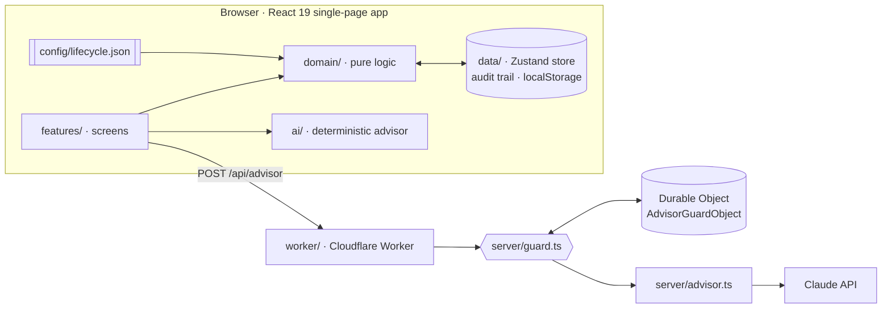
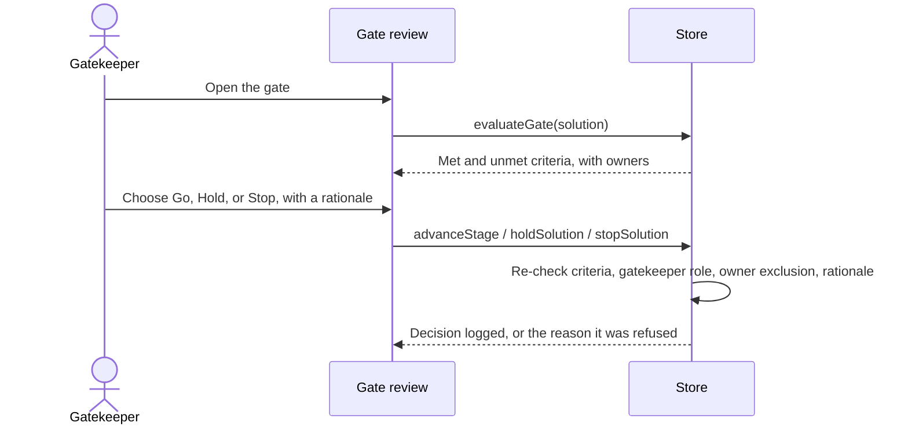

# Architecture

**v1.0 · 10.11.2026** · Forge AI Solution Navigator 1.2

## Goals and constraints

| Goal | Consequence for the design |
|---|---|
| A public demo anyone can use without an account | Each visitor's data stays in their own browser. No accounts, no shared database. |
| The methodology must be adaptable to any company | Stages, gates, activities, evidence, roles, and weights live in one configuration file. |
| A person, never the system, makes every decision | Gate decisions are human, attributed, explained, and re-validated by the store. |
| The AI advises; it never approves | The advisor is read-only, has a free deterministic fallback, and sits behind spend and rate limits. |
| $0 to run by default | Static hosting on Cloudflare, with the live Claude advisor optional and capped. |

## System overview

Static assets are served directly by Cloudflare; only `/api/*` runs the Worker. The single-page app falls back to `index.html` for every route.

## Layers

Dependencies point one way: **features → domain → data → AI integration.**

| Layer | Folder | Responsibility | Depends on React? |
|---|---|---|---|
| Methodology | `src/config/` | `lifecycle.json` plus typed accessors and the glossary | No |
| Domain | `src/domain/` | Readiness, gate evaluation, gatekeepers, health, next best action, plan instantiation, reports, validation | No |
| Data | `src/data/` | The store: every action, the audit trail, persistence, seed data, derived hooks | Hooks only |
| AI | `src/ai/`, `server/` | The advisor contract, context builder, deterministic advisor, client, and the server integration | No |
| UI | `src/components/`, `src/features/` | Design system and screens | Yes |

Because the domain is plain TypeScript, the core rules are tested without rendering anything.

## The methodology as configuration

`src/config/lifecycle.json` (v1.1.0) defines:

- **8 stages** in 3 phases (Plan, Deliver, Run), each with a purpose, typical duration, and expected readiness.
- **7 gates**, one at the end of every stage except the last, each with explicit criteria and its **gatekeeper roles**.
- **60 activity templates** and **41 evidence templates**, each tagged with the risk tiers that require or block on it.
- **3 risk tiers** (low, moderate, high), **15 roles**, and **7 readiness dimensions**: Business Value, Product Readiness, Technical Readiness, AI Evaluation, Risk & Governance, Operational Readiness, and Adoption Readiness.

Creating a solution instantiates a plan from the templates for its risk tier. Changing the tier reconciles the plan in place and keeps completed work. See [ADR 0001](adr/0001-methodology-as-configuration_v1.0_10.11.2026.md).

## Gates and decisions

- **Evaluation:** a gate passes only when every blocking activity for the solution's risk tier is complete *with approved evidence*, and every explicit criterion (fields, roles, metrics, risk rules) holds.
- **Decision rights:** only a team member holding one of the gate's gatekeeper roles may decide, and never the solution owner. See [ADR 0005](adr/0005-gatekeepers-go-hold-stop_v1.0_10.11.2026.md).
- **Lifecycle state:** `active`, `on_hold`, or `stopped`, kept separate from health so a deliberate pause never reads as a problem. Stopped solutions leave portfolio totals; held ones leave Needs attention.
- **Audit:** every change records who, what, from, and to.

## Persistence

The store persists through a `StateStorage` adapter (`src/data/storage.ts`) to `localStorage`, versioned with a reseed on any version mismatch so old demo data never breaks a new release. Swapping in a server database is a one-file change. See [ADR 0002](adr/0002-browser-local-persistence_v1.0_10.11.2026.md).

## The AI advisor

1. The browser builds a compact JSON snapshot of the solution or portfolio (`src/ai/context.ts`).
2. In live mode it posts to `/api/advisor`. The Worker checks the origin, a client header, the body size (64 KB), the visitor's limits (6 a minute, 20 a day, keyed by an anonymous hash), and the site-wide daily budget (default $5), all held in a Durable Object.
3. `server/advisor.ts` calls Claude with structured JSON output, validates the answer, and logs model, tokens, cost, and latency.
4. Any refusal, limit, or failure falls back to the deterministic advisor in the browser, which costs nothing.

The advisor can explain and recommend. It cannot approve, change lifecycle state, or make legal or security determinations. See [ADR 0003](adr/0003-advisor-recommends-people-decide_v1.0_10.11.2026.md).

## Security

See [SECURITY.md](../SECURITY.md). In short: no secrets in the repository, server-side re-validation of decisions, advisor guardrails, and browser hardening headers served from `public/_headers`.

## Testing and delivery

- **30 Vitest tests:** domain rules, gatekeepers and decisions, advisor areas, and server guardrails.
- **CI** ([`ci.yml`](../.github/workflows/ci.yml)): every pull request is tested and built; every merge to `main` deploys and then confirms the live site serves the new build.
- **Dependabot** keeps npm packages and GitHub Actions current.

## Known trade-offs

| Choice | Trade-off | When to revisit |
|---|---|---|
| Browser-local data | No collaboration between people | When teams need one shared workspace |
| One configuration file | Large JSON to edit by hand | When a methodology editor is worth building |
| Deterministic advisor by default | Less fluent than the live model | Already optional: set `ANTHROPIC_API_KEY` |
