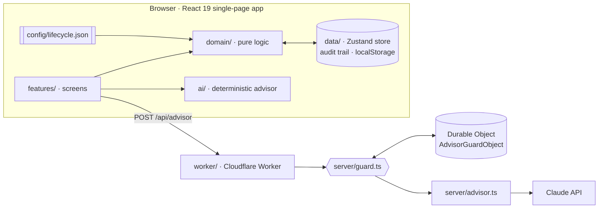
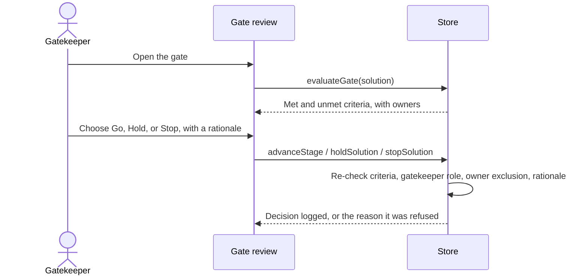

# Architecture

**v2.0 · 10.29.2026** · Forge Navigator 2.0

## Goals and constraints

| Goal | Consequence for the design |
|---|---|
| A public demo anyone can use without an account | Each visitor's data stays in their own browser. No accounts, no shared database. |
| The methodology must be adaptable to any company | Stages, gates, activities, evidence, roles, and weights live in one configuration file. |
| A person, never the system, makes every decision | Gate decisions are human, attributed, explained, and re-validated by the store. |
| Nobody signs off their own work | Evidence is approved by a teammate who isn't its owner, and the store refuses every other route to Approved. |
| The AI advises; it never approves | The advisor is read-only, has a free deterministic fallback, and sits behind spend and rate limits. |
| $0 to run by default | Static hosting on Cloudflare, with the live Claude advisor optional and capped. |

## System overview

Static assets are served directly by Cloudflare; only `/api/*` runs the Worker. The single-page app falls back to `index.html` for every route.

## Layers

Dependencies point one way: **features → domain → data → AI integration.**

| Layer | Folder | Responsibility | Depends on React? |
|---|---|---|---|
| Methodology | `src/config/` | `lifecycle.json` plus typed accessors and the glossary | No |
| Domain | `src/domain/` | Readiness, gate evaluation, gatekeepers, evidence approval, health, next best action, plan instantiation, reports, and the store rules in `validation.ts` | No |
| Data | `src/data/` | The store: every action, the audit trail, persistence, seed data, derived hooks | Hooks only |
| AI | `src/ai/`, `server/` | The advisor contract, context builder, deterministic advisor, client, and the server integration | No |
| UI | `src/components/`, `src/features/` | Design system and screens | Yes |

Because the domain is plain TypeScript, the core rules are tested without rendering anything.

## The methodology as configuration

`src/config/lifecycle.json` (v1.1.0) defines:

- **8 stages** in 3 phases (Plan, Deliver, Run), each with a purpose, typical duration, and expected readiness.
- **7 gates**, one at the end of every stage except the last, each with explicit criteria and its **gatekeeper roles**. A criterion is a documented field, an assigned role, defined metrics, a risk rule, or a measured result against a threshold (`metric_threshold`).
- **60 activity templates** and **41 evidence templates**, each tagged with the risk tiers that require or block on it.
- **3 risk tiers** (low, moderate, high), **15 roles**, and **7 readiness dimensions**: Business Value, Product Readiness, Technical Readiness, AI Evaluation, Risk & Governance, Operational Readiness, and Adoption Readiness.

Creating a solution instantiates a plan from the templates for its risk tier. Changing the tier reconciles the plan in place and keeps completed work. See [ADR 0001](adr/0001-methodology-as-configuration_v1.0_10.11.2026.md).

## Gates and decisions

- **Evaluation:** a gate passes only when every blocking activity for the solution's risk tier is complete *with approved evidence*, and every explicit criterion (fields, roles, metrics, risk rules, measured thresholds) holds.
- **Measured thresholds:** a `metric_threshold` criterion compares a metric's measured value with the target the team set beforehand, and applies only to the risk tiers it names. The Feasibility & Risk Gate uses one: for Moderate and High risk, the spike's measured result on sample data must meet its threshold.
- **Blocked gates put fixing first:** while a gate is blocked, the review's main button is "Resolve next blocker". Opening a gate to look logs nothing; only a gatekeeper's Go, Hold, or Stop is recorded, and gate pass rate counts those decisions alone.
- **Decision rights:** only a team member holding one of the gate's gatekeeper roles may decide, and never the solution owner. See [ADR 0005](adr/0005-gatekeepers-go-hold-stop_v1.0_10.11.2026.md).
- **Lifecycle state:** `active`, `on_hold`, or `stopped`, kept separate from health so a deliberate pause never reads as a problem. Stopped solutions leave portfolio totals; held ones leave Needs attention.
- **Audit:** every change records who, what, from, and to.

## Evidence and readiness

Evidence is the proof that work met the standard, so the person who produced it never signs it off. See [ADR 0006](adr/0006-evidence-approved-by-a-second-person_v1.0_10.29.2026.md).

- **Moves:** anyone on the team moves evidence from Missing to Draft to In Review, and back to Draft (`src/domain/evidence.ts`).
- **Approval:** only from In Review, by a team member who isn't the owner, with a one-line note. The approval records who, when, and the note, and history shows whose evidence it was and which activity it backs.
- **Readiness credit:** readiness tells the same story as the gate, so finished work counts in full only when its evidence is approved.

| Evidence on a completed activity | Credit |
|---|---|
| Approved, or not required | 1 |
| In review | 0.7 |
| Draft | 0.4 |
| Missing, on a gate-blocking activity | 0 |
| Missing, on any other activity | 0.3 |

Work still in progress earns a small bonus once its evidence is underway, and approving early never lowers the score. Dimension scores roll up into overall readiness by the weights in Settings.

## Store rules

Every activity, evidence, and solution change passes through `src/domain/validation.ts` before the store writes it, so a rule holds no matter which screen made the change:

- required activities can't be marked Not Applicable;
- evidence can't be approved without an approver, by its owner, or through a plain edit;
- stage and lifecycle state change only through Go, Hold, Stop, or Resume.

Each refusal comes back as `{ ok: false, reason }`, and the screen shows the reason as a toast. The UI only offers allowed moves, so the toasts are a safety net.

## Screens

- **My Overview** is personal: what needs your attention, your work this week, and decisions waiting on you. **Portfolio** (at `/reports`, with `/portfolio` leading there) is the whole portfolio.
- **A solution's workspace** has five tabs: Overview, Work, Risks & decisions, Metrics, and Team & history (`src/features/workspace/routes.ts`). Evidence lives inside Work, next to the activity it proves. Stages open from the lifecycle bar in a side panel (a bottom sheet on phones). Old tab links still land in the right place.
- **One AI entry point per page:** an "Ask AI about this page" button beside each page title.

## Persistence

The store persists through a `StateStorage` adapter (`src/data/storage.ts`) to `localStorage`, versioned (currently 4) with a reseed on any version mismatch so old demo data never breaks a new release. Saved data is treated as untrusted input: on load, `src/data/persistence.ts` checks its shape (every collection, record ids, known stages, settings) and falls back to a fresh demo if anything is malformed. Swapping in a server database is a one-file change. See [ADR 0002](adr/0002-browser-local-persistence_v1.0_10.11.2026.md).

## The AI advisor

1. The browser builds a compact JSON snapshot of the solution or portfolio (`src/ai/context.ts`).
2. In live mode it posts to `/api/advisor`. The Worker refuses oversized requests from their declared length before reading them, then checks the origin, a client header, the body size (64 KB), the visitor's limits (6 a minute, 20 a day, keyed by an anonymous hash), and the site-wide daily budget (default $5), all held in a Durable Object that deletes earlier days' counters.
3. `server/advisor.ts` calls Claude with structured JSON output, validates the answer, and logs model, tokens, cost, and latency.
4. Any refusal, limit, or failure falls back to the deterministic advisor in the browser, which costs nothing.

The advisor can explain and recommend. It cannot approve, change lifecycle state, or make legal or security determinations. See [ADR 0003](adr/0003-advisor-recommends-people-decide_v1.0_10.11.2026.md).

## Security

See [SECURITY.md](../SECURITY.md). In short: no secrets in the repository, server-side re-validation of decisions, advisor guardrails, and browser hardening headers served from `public/_headers`.

## Testing and delivery

- **84 Vitest tests:** domain rules, the readiness, next-action and Portfolio calculators (checked against a hand-worked fixture portfolio), the store rules, gatekeepers and decisions, advisor areas, the sidebar memory, saved-data validation, tour placement, and server guardrails.
- **One Playwright test** (`e2e/demo.e2e.ts`) runs the README demo in Chromium against the production build: submit Erin's UAT Sign-off for review, approve it as Dwight, finish the activity, and see the gate go from 3 open to 2.
- **CI** ([`ci.yml`](../.github/workflows/ci.yml)) has three jobs. "Test and build" and "End-to-end" run on every pull request. On every merge to `main`, the deploy job waits for both, deploys to Cloudflare with the repository's `CLOUDFLARE_API_TOKEN` and `CLOUDFLARE_ACCOUNT_ID` secrets, and then confirms the live site serves the new build.
- **Dependabot** keeps npm packages and GitHub Actions current.

## Known trade-offs

| Choice | Trade-off | When to revisit |
|---|---|---|
| Browser-local data | No collaboration between people | When teams need one shared workspace |
| One configuration file | Large JSON to edit by hand | When a methodology editor is worth building |
| Deterministic advisor by default | Less fluent than the live model | Already optional: set `ANTHROPIC_API_KEY` |
